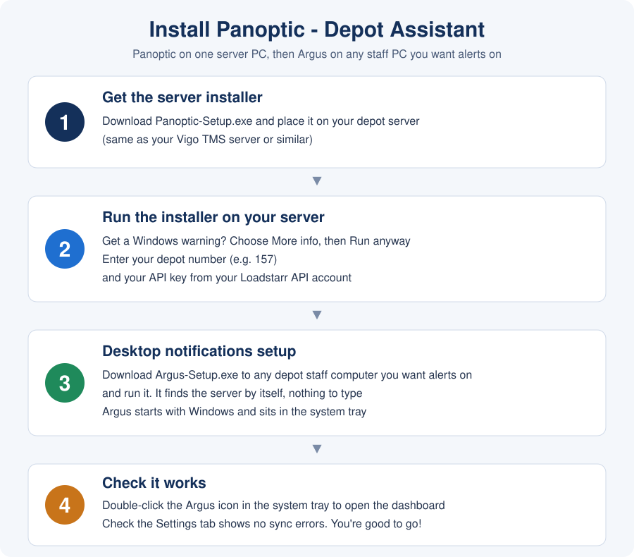

# Panoptic - Depot Assistant

Watches Pallet-Track for your depot and tells staff when something needs attention: late or missing ETAs, goods on dock, damage, drivers waiting, jobs with no proof of delivery.

It has two parts:

- **Panoptic**: the server and dashboard. It runs on one always-on Windows PC at the depot and holds the data and your depot's API key.
- **Argus**: the desktop assistant. It runs on each staff PC, raises the alerts as Windows notifications, and opens the dashboard when you double-click its tray icon.

This repository holds downloads only. Get the files from the [Releases page](../../releases/latest).

## Before you start

- A Windows PC at the depot that stays on during working hours, such as your Vigo TMS server. The install turns off sleep on mains power.
- Your depot number (the Pallet-Track code, for example 157 or 093).
- Your API key, from your Loadstarr API account.
- Administrator rights on the server PC. Staff PCs need none.

## 1. Get the server installer

Download `Panoptic-Setup.exe` from the latest release and place it on your depot server.

## 2. Run the installer on your server

1. Run `Panoptic-Setup.exe`.
2. If Windows says it protected your PC, choose **More info**, then **Run anyway**. The installers are not code signed yet.
3. Enter your depot number (for example 157) and your API key. The key is checked against Pallet-Track before the install continues.
4. Leave the port as 5157 unless something else uses it.
5. Optional: set a PIN. With a PIN, staff are asked for it before they send or change anything from the dashboard.
6. Pick where the depot is (England or Wales, Scotland, Northern Ireland) so bank holidays are right.
7. Finish the wizard. It installs the service, opens the firewall for your local network only, and starts it.

## 3. Desktop notifications setup

On any depot staff computer you want alerts on:

1. Download `Argus-Setup.exe` from the latest release and run it. No administrator rights are needed.
2. Finish the wizard. Argus finds the server on your network by itself, so there is nothing to type, and starts with Windows. It sits in the system tray.

If your network keeps devices apart (separate VLANs or Wi-Fi isolation), Argus cannot find the server and asks for its name or IP instead, for example `192.168.0.20`.

## 4. Check it works

- Double-click the Argus icon in the system tray. The dashboard opens.
- On the dashboard, the **Settings** tab should show no sync errors. You're good to go!
- The first postcode routing refresh runs by itself and takes about 12 minutes.
- If the server stays silent for 5 minutes Argus raises a warning. If the server comes back on a new address after a power cut, Argus finds it again by itself.
- Notifications are held back from 06:00 to 08:00 while the day's data loads, then run until 19:30, Monday to Friday.

## One person, one PC

If only one person watches Pallet-Track on one computer, use `Panoptic-OnePC-Setup.exe` instead of the two installers above. It is a separate installer and does not touch the depot server install.

1. Download `Panoptic-OnePC-Setup.exe` and run it on that PC. Choose **Run anyway** if Windows warns you.
2. Enter your depot number and API key, and pick your region. It installs Panoptic and Argus together, so there is nothing else to set up.
3. Double-click the Argus icon in the system tray to open the dashboard.

What is different from a depot server:

- The dashboard works on this PC only, and the installer changes no firewall or sleep settings.
- The PC can be shut down every night. When it starts, Panoptic catches up on the hours it missed. Argus stays quiet for about 10 minutes, then shows one summary of what needs attention.
- The 06:00 special measures chase and the 11:00 ETA Chase auto-send are skipped on a day the PC was not on at that time. Nothing is posted late.
- Updates do not install overnight. Argus shows an **Install now** notification when one is ready, and you choose when.
- The installer refuses to run on a PC that already runs Panoptic as a depot server.

## Updates

Servers check for new releases once a night and install them between 02:00 and 05:00 on a quiet day. Staff PCs take the new Argus from their own server. If an update fails, the previous version and database are put back. The **Settings** tab has **Check now** and **Install now** buttons, and shows the result.

The other files on the release page (the server zip, `PtMonitor.Tray.exe` and `release-manifest.json`) are what servers download for these updates. You do not need them.

## Problems

- **Argus cannot reach the server**: check the server PC is on. From a staff PC, `http://<server>:5157` should open in a browser. Use the tray menu's **Change server address** if you need to point Argus at it by hand.
- **Service does not start after a reboot**: re-run `Panoptic-Setup.exe` and tick the Windows Defender exclusion option.
- **API key rejected**: the installer says so before it installs anything. Check the key and the depot number.

When reporting a fault, send the contents of the server's `logs` folder and `install-result.txt` from the install folder.
